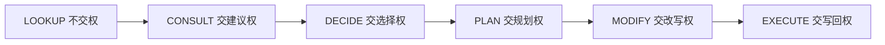
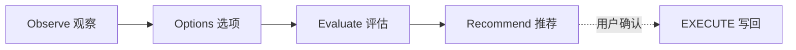
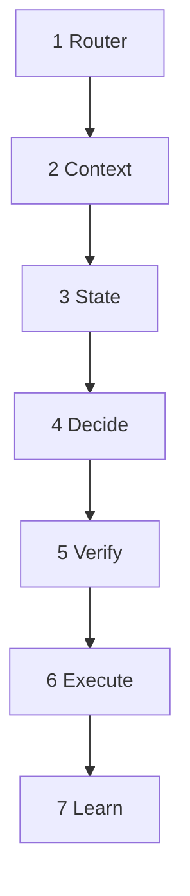
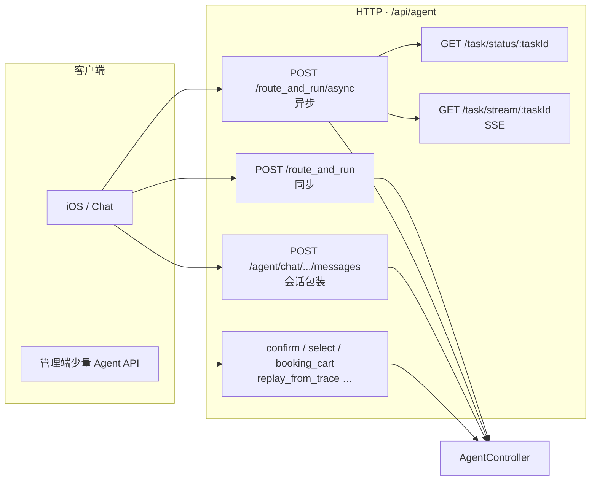
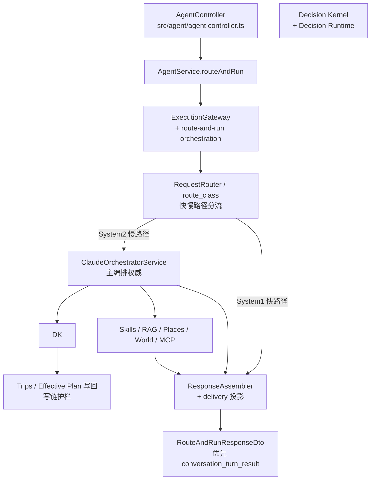
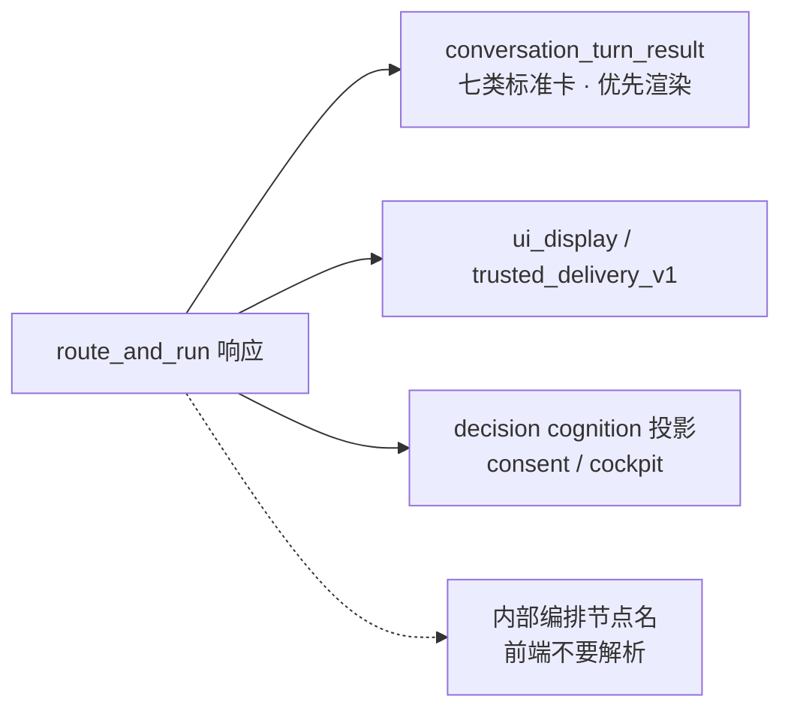

# TripNARA 新人上手：项目逻辑结构

> 面向刚接手本仓库的研发。先建立「请求怎么走、代码在哪、别误删什么」的心智模型，再下钻细节。  
> 产品愿景与环境搭建见根目录 [`README.md`](./README.md)。

---

## 1. 一句话定位

TripNARA 是 **NestJS 旅行决策 / 路线认知 Agent**：判断「这条路该不该这样走、风险在哪、怎么调整」。

**不做**交易履约（代订、库存、GDS 深集成）。**只做**决策、风险识别与可解释建议。

---

## 2. 技术栈（够用即可）

| 层 | 选型 |
|----|------|
| API | NestJS 11 + TypeScript 5 |
| DB | PostgreSQL + PostGIS，Prisma 6 |
| 缓存 | Redis（本地常可关，见 `main.ts`） |
| Agent | LangGraph / LLM 编排 |
| 旁路 | `python/`（embedding / judge / solver / train）、`tripnara-cli/` |

本地入口：`npm install` → 配根目录 `.env` → `npm run dev` / `npm run build`。  
场景化 env 模板在 [`config/env/`](./config/env/)，按需追加进 `.env`。

---

## 3. 仓库怎么分层看

不要从根目录「扫一百个文件夹」开始。按五层记：

```text
HTTP / Swagger
    → src/                 业务与 Agent（几乎所有需求落点）
    → prisma/ + data/      表结构 + 静态领域数据
    → config/ + prompts/   运行配置样例 + LLM 提示词
    → scripts/ + python/ + tripnara-cli/   导入、评测、旁路服务、CLI
    → internal-docs/ + docs/ + artifacts/  文档与可再生报告
```

### 3.1 根目录（精简后）保留的是什么

| 文件 | 作用 |
|------|------|
| `package.json` / lock | 依赖与 npm 脚本 |
| `tsconfig*.json` / `nest-cli.json` / `jest.config.js` | 编译、Nest、测试 |
| `prisma.config.ts` | Prisma 配置入口 |
| `.env` | 本地密钥（勿提交） |
| `Dockerfile` / `docker-compose.yml` / `entrypoint.sh` | 容器 |
| `Jenkinsfile` | CI 流水线 |
| `change-impact-descriptor.v1.json` | PR/CI 变更影响契约（改契约敏感路径时要更新） |
| `README.md` / 本文件 | 产品说明 / 新人结构说明 |

专题架构与旧结构说明已迁到 `internal-docs/`（见文末索引）。

### 3.2 一级目录速查

| 目录 | 干什么 | 新人优先级 |
|------|--------|------------|
| **`src/`** | Nest 主应用：API、Agent、决策、行程、RAG… | ★★★ 必读 |
| **`prisma/`** | Schema + migrations | ★★★ 改表必看 |
| **`data/`** | 国家包、约束、冰岛静态数据、RAG 语料等 | ★★ 做数据/导入时 |
| **`config/`** | env 模板、decision-runtime、策略等 | ★★ |
| **`prompts/`** | Agent/Skill 提示词 | ★★ 改话术/Agent 时 |
| **`scripts/`** | 导入、迁移、评测、门禁、运维 | ★★ |
| **`tripnara-cli/`** | 独立 CLI / DSL / 回放 | ★ 按需 |
| **`python/`** | 嵌入、评判、OR-Tools、训练 | ★ 按需 |
| **`docker/`** / **`monitoring/`** | 旁路镜像、Prometheus/Grafana | ★ 按需 |
| **`test/`** / **`tests/`** / **`e2e-cases/`** / **`fixtures/`** | 基准与夹具（**勿删**） | ★ 写测时 |
| **`baselines/`** | CGUS 等回放基线 | ★ 评测时 |
| **`artifacts/`** | 门禁/回放**产物落盘**（可再生；仅保留约定样例） | 低 |
| **`evidence/`** | 发布/主张证据包 | 低（勿当垃圾删） |
| **`internal-docs/`** | 可推送的设计/归档文档 | ★★ |
| **`docs/`** | 本地文档区（仓库 `.gitignore` 忽略，未必进 git） | 视环境 |
| `dist/` / `node_modules/` / `logs/` / `uploads/` | 构建、依赖、运行时 | 可清可再生 |

---

## 4. 运行时逻辑（主链）

```text
客户端
  → POST /agent/route_and_run（及 chat / mobile 别名）
      → Agent 路由 + 编排（ExecutionGateway / Orchestrator）
          → Skills / RAG / Places / 世界模型 / MCP 能力
              → Decision Kernel + Decision Runtime（门控 / shadow / 写链）
                  → 行程侧决策与 Effective Plan 写回（有护栏）
```

**装配真相源：** `src/app.module.ts`（哪些 Module 真正挂载；注释掉的 ≠ 磁盘上没有代码）。  
**启动入口：** `src/main.ts`（全局管道、Swagger、启动期断言）。

### 4.1 `src/` 按改需求找目录

| 你要改的事 | 优先看 |
|------------|--------|
| 对话 / `route_and_run` / 异步任务 | `src/agent/`（`agent.controller.ts`、orchestration、routing、response-assembler） |
| **记忆** | `src/agent/memory/`（Memory OS 主读）、`src/travel-memory/`（TMR 并行） |
| **LLM / 推理调用** | `src/llm/` + `ClaudeOrchestratorService` + `src/agent/orchestration/graph/` |
| **iOS / 前端接口契约** | **`src/agent/delivery/`**（`*IOS_HANDOFF*`）、**`src/mobile/`**；字段 SSOT 多为同目录旁的 `*.dto.ts` |
| **管理后台接口** | **`src/admin/`**（`ADMIN_API_GUIDE.md` 总览）+ 各域 `*/admin` Controller；路径多在 `/api/admin/*` 或 `/api/<域>/admin` |
| 可调用能力颗粒 | `src/skills/`、`src/llm/` |
| 决策内核 / 校验 / 应急 | `src/decision/` |
| 运行时门控、shadow、生产切换 | `src/decision-runtime/`（先读 `PRODUCTION_TRANSITION.md`） |
| 行程 CRUD / 行程侧决策优化 | `src/trips/`（含 `trips/decision`） |
| 地点 / RAG / 知识 | `src/places/`、`src/rag/`、`src/knowledge-base/` |
| 认证用户管理 | `src/auth/`、`src/users/`、`src/admin/` |
| 外部能力接入 | `src/mcp/` 及各类 `*Direct` 模块 |
| 回放与契约评测 | `src/harness/` |

> **现状：** Canonical / Kernel 与 Legacy、Shadow **并存**。看到两套实现不要直接删；先查开关与 `PRODUCTION_TRANSITION.md`。Legacy 退役条件尚未满足。

---

## 4.2 智能体接口架构逻辑

### 用文字说明

智能体对外几乎都收口在 **`/api/agent`**，核心是 **`route_and_run`（路由并执行）**。

**一、客户端怎么进来**

1. **iOS / Chat 主路径**
   - 短问答、小改行程：直接 `POST /api/agent/route_and_run`，等同步结果。
   - 规划、大改（推荐）：`POST /api/agent/route_and_run/async` 拿任务 ID，再用 `GET .../task/status/:taskId` 轮询，或 `GET .../task/stream/:taskId` 收 SSE。
   - 带会话的聊天：走 `POST /api/agent/chat/.../messages`，服务端落库后再调同一套 `route_and_run`。
2. **附属动作**（确认谈判、选择方案、购物车应用、按 trace 回放等）：仍在 `AgentController` 上，路径不同，但同属 Agent 域。
3. **统一入口类**：`src/agent/agent.controller.ts`（Swagger tag：`agent`）。

**二、进门之后后台怎么跑**

1. Controller 把请求交给 **`AgentService.routeAndRun`**。
2. 进入 **ExecutionGateway + route-and-run 编排**（`execution-gateway.route-and-run.orchestration.ts`）：做稳定性、超时、恢复、治理分支等。
3. **路由分流（route_class / RequestRouter）**
   - **System 1（快）**：简单查询 / 轻量路径，尽快组装响应。
   - **System 2（慢）**：交给 **`ClaudeOrchestratorService`** 做主编排（多步推理、调工具）。
4. 编排过程中会调用能力层：**Skills**、**RAG**、**Places**、世界模型、**MCP/外部能力** 等。
5. 需要判断「该不该这样走」时进入 **Decision Kernel + Decision Runtime**（门控、shadow、约束），必要时写回行程（**Effective Plan**，有写链护栏）。
6. 结果经 **ResponseAssembler** 和 **`src/agent/delivery/`** 打成前端可消费的投影，返回 **`RouteAndRunResponseDto`**。

**三、前端应该读响应里的什么**

优先级从高到低：

1. **`conversation_turn_result`**：单轮对话标准信封 / 标准卡（Chat、iOS **优先只渲染这个**）。
2. **`ui_display` / `trusted_delivery_v1`**：展示与投递约定。
3. **决策认知投影**（consent / cockpit 等，见 `DECISION_COGNITION_IOS_HANDOFF`）。
4. **不要**把内部编排节点名、内部 trace 结构当 UI 合同去解析。

**四、一句话串起来**

> 客户端 → `route_and_run`（同步或异步）→ AgentController → AgentService → Gateway 编排 → 快/慢分流 →（慢路径）Orchestrator 调 Skills/RAG/决策 → 组装 delivery 响应 → iOS 优先画 `conversation_turn_result`。

对接细则：[`FRONTEND_ROUTE_AND_RUN_IOS_HANDOFF.md`](./src/agent/delivery/FRONTEND_ROUTE_AND_RUN_IOS_HANDOFF.md)。

### 记忆机制（Memory）

当前是 **双轨**：旧 **Memory OS** 仍是默认主硬读路径；**Travel Memory Runtime（TMR）** 并行写入 / Context Assembly；**EffectiveTravelerContext** 为统一读投影（`EFFECTIVE_TRAVELER_CONTEXT_CONSUME` 控制 shadow/active）。Traveler Memory Contract（8×5）与 Trip Override（「这次不一样」）已接线，详见 `src/travel-memory/TMR_READINESS.md`。

| 层 | 目录 | 作用 |
|----|------|------|
| Memory OS（主读） | `src/agent/memory/` | 组装 `AgentMemoryContext`，注入编排与决策参数 |
| Travel Memory Runtime | `src/travel-memory/` | 决策经验 / Episode 等；shadow 或选择性 soft |
| 旁路 | `src/agent/context-engine/`（TripTaskMemory）、`src/agent/state-learning/` 等 | 任务态、事件账本等补充 |

**Memory OS 大致记什么（L0–L4 心智模型）**

- L0 用户基础设置；L1 旅行人格/偏好；L2 近期决策与 ledger  
- L3 路线健康 / 失败模式；L4 行程反馈；另有 party profile、世界决策归档、activeTripState 等  

**存储技术栈**

| 技术 | 用途 |
|------|------|
| **PostgreSQL + Prisma** | 记忆与画像持久化；TMR Durable Ledger |
| **Redis**（`ioredis` / cache-manager） | Memory snapshot 等缓存；无 Redis 时常降级跳过 |
| 进程内 Map / LedgerStore | DB 不可用或热路径缓冲 |
| **Qdrant** | **不是**记忆主存；主要用于实体解析（向量 ER） |

开关心智：`TRAVEL_CONTEXT_ASSEMBLY=off|shadow|consume`（默认多为 off/shadow 观察）；读决策主路径仍先过 Memory OS。  
入口：`memory-context-assembler.service.ts`、`memory.service.ts`；TMR：`travel-memory-runtime.service.ts`。说明见 `src/travel-memory/TMR_READINESS.md`、`internal-docs/architecture/ADR-TRAVEL-MEMORY-RUNTIME.md`。

### Agent 推理机制与技术栈

**架构标签（文档/注释口径）**：**COALA 骨架 + ReAct 思维流** 的双系统——  
- **System 1（快）**：轻量查询 / 简单路径，秒级内返回倾向  
- **System 2（慢）**：多步编排、工具调用、规划（可到数十秒）

**生产主编排（权威）**

| 组件 | 技术 / 位置 | 说明 |
|------|-------------|------|
| HTTP 入口 | NestJS `AgentController` | `route_and_run` |
| 编排服务 | `ClaudeOrchestratorService` | **主编排权威**（状态机 / Dynamic DAG） |
| 图调度 | `src/agent/orchestration/graph/` | **自研** scheduler（INTAKE→RESEARCH→PLAN_GEN→GATE→VERIFY…） |
| 分流 | RequestRouter / route_class | System1 vs System2 |
| 能力调用 | `src/skills/` + SkillsRegistry | LLM/规则选 skill 后执行 |
| 决策 | Decision Kernel + Decision Runtime | 约束、门控、写回 |
| 响应 | ResponseAssembler + `delivery/` | 前端投影 |

**LEGACY / 回退（仍可能走到）**

- `RouterService` + `plan-execute` DAG  
- 失败时降级 **ReAct** 循环（Plan → Act → Observe → Critic → Repair），见较旧的 `orchestrator.service.ts`  
- 模式名常见：`CLAUDE_SM` / `CLAUDE_DYNAMIC` / `LEGACY`（以 `agent.service` 配置为准）

**LLM 技术栈（`src/llm/`）**

| 项 | 说明 |
|----|------|
| 调用方式 | `LlmService` + `ModelRouter`，多为 **HTTP（axios）** 调兼容 API |
| 支持提供方 | openai / anthropic / gemini / deepseek / **vllm** 等（见 llm DTO） |
| 路由策略 | vLLM-first / API-first / AUTO 等可配 |
| LangChain | package 含 `@langchain/core`、`@langchain/langgraph`、`@langchain/openai` |
| LangGraph 现状 | **依赖在仓，主编排未以 LangGraph StateGraph 为生产核心**（自研 Claude SM 图为主；LangGraph 相关多为集成/遗留） |
| MCP | `@modelcontextprotocol/sdk`，外部工具能力 |

**和记忆怎么接：** 编排前 `prepareTick` 装载 Memory OS + 投影 ETC；决策参数默认 Injector 读 OS，可切 ETC；TMR soft hints / ETC advisory 进 CGUS（非硬约束）。Trip Override 与脏写门控见 `TRAVEL_MEMORY_API.md`。

### 4.3 产品六图：Journey · Taxonomy · Context · Decision · Authority · Runtime

> 可交互总览：Cursor Canvas **`agent-product-architecture`**（六表合一）。

#### ① Agent Journey · 用户什么时候把决策交给 Nara

| 用户阶段 | 任务类 | 典型说法 | 是否把决策交给 Nara |
|----------|--------|----------|---------------------|
| 开场 / 问事实 | LOOKUP | 营业时间、天气、某日安排 | **否**——只要答案 |
| 讨论取舍 | CONSULT | 「西峡还是南岸？」 | **半交**——要建议，决定权仍在用户 |
| 确认方案 | DECIDE | 选候选 / 接受推荐 | **是**——把「选哪个」交给 Nara（或确认其推荐） |
| 生成行程 | PLAN | 「帮我排 7 天」 | **是**——把「怎么排」交给 Nara（多为草案） |
| 改局部 | MODIFY | 换酒店、绕开封路 | **是**——授权局部改写，写回常需确认 |
| 落地写回 | EXECUTE | 应用草案 / 写 Effective Plan | **最高授权**——改权威状态 |



#### ② Task Taxonomy · 六类任务（映射本仓库）

| Taxonomy | 含义 | 仓库近似 | 编排倾向 |
|----------|------|----------|----------|
| LOOKUP | 查事实 | `DATA_LOOKUP` / `QUICK_ANSWER` | System1 轻量，不抢写锁 |
| CONSULT | 咨询比较 | consultation / trip-scoped consult | 出选项卡，默认可不写行程 |
| DECIDE | 做选择 | decision select / GATE / recommend | 决策 ID / 推荐，写回前常确认 |
| PLAN | 规划 | `FULL_DEEP_PLAN` / trip planning | Claude SM + 决策内核 |
| MODIFY | 修改 | `PARTIAL_REPLAN` / `LOCAL_EDIT` | 局部重算 |
| EXECUTE | 执行写回 | apply / `PLAN_APPLIED` / Write Guard | 经授权与写链护栏 |

#### ③ Context Matrix · 每类任务要什么 State / Evidence

| 任务 | State | Evidence | 记忆侧 |
|------|-------|----------|--------|
| LOOKUP | 可选 trip 摘要 | POI/天气/开放时间等事实 | Memory L0–L1 可选 |
| CONSULT | 行程片段 + 偏好 | 候选对比、约束摘要 | L1–L2 |
| DECIDE | 决策空间 / 选项集 | 评分、风险、覆盖声明 | Decision Runtime + Ledger |
| PLAN | 完整 Trip + 画像 | 地理/天气/道路/体力世界模型 | Memory 全层 + RAG/Skills |
| MODIFY | 当前草案 + 变更意图 | 触发证据（封路/冲突） | version / lock |
| EXECUTE | 已授权 Decision + 版本 | 写链证据、幂等键 | Write Guard / UWC |

**规则：** State 或 Evidence 不足时，应降级为 LOOKUP/CONSULT，禁止硬冲 PLAN/EXECUTE。

#### ④ Decision Flow · Observe → Options → Evaluate → Recommend



- **Observe**：Memory + Trip + 世界证据（Runtime 的 Context/State）。  
- **Options**：可比较方案（绕行/改日/换住等）。  
- **Evaluate**：GATE / Constraint / Decision Kernel。  
- **Recommend**：推荐与解释；**默认不直接写权威计划**，确认后才 EXECUTE。

#### ⑤ Authority Matrix · 自动 / 确认 / 禁止

| 动作 | 权限 | 规则 |
|------|------|------|
| LOOKUP 读事实 | **可自动** | 无行程写副作用 |
| CONSULT 出建议卡 | **可自动** | 默认不写 Effective Plan |
| DECIDE 推荐默认项 | **可自动推荐** | 采纳/写回通常要确认 |
| PLAN 生成草案 | **可自动出草案** | 应用进正式行程 → 确认 |
| MODIFY 局部改写 | **预览可自动** | commit 需确认或明确授权 |
| EXECUTE 写 Effective Plan | **仅白名单** | 默认需 `DECISION_AUTHORIZED` |
| 代订 / 支付履约 | **禁止** | 产品边界：不做交易履约 |
| Shadow 静默写主计划 | **禁止** | 生产切换期硬约束 |

工程表见 [`CANONICAL_AUTHORITY_AUDIT.md`](./src/decision-runtime/CANONICAL_AUTHORITY_AUDIT.md) §Authority Matrix。

#### ⑥ Agent Runtime · Router → … → Learn



| 阶段 | 做什么 | 代码锚点 |
|------|--------|----------|
| Router | 意图 / Taxonomy / route_class | RequestRouter · unified-intent |
| Context | Memory + Trip + 证据 | MemoryContextAssembler · RAG |
| State | 可决策状态 | Travel Context · World model |
| Decide | Observe→Options→Evaluate→Recommend | Decision Kernel / Runtime |
| Verify | 门控 / 版本 / 写链 | GATE · Write Guard · Gateway |
| Execute | 授权写回 | Effective Plan · apply |
| Learn | 反馈与经验 | Memory write · TMR shadow |

**串起来：** Router 定 Taxonomy → Context Matrix 补齐 → Decide 四步 → Authority Matrix 卡点 → 仅授权后 Execute → Learn。

### 示意图：接口面（客户端怎么进来）



### 示意图：编排主链（进门之后怎么走）



### 示意图：响应给前端看什么



**代码锚点：** Controller → `AgentService` → `execution-gateway.route-and-run.orchestration.ts` → `ClaudeOrchestratorService` → Assembler / `src/agent/delivery/`。  
**对接文档：** [`FRONTEND_ROUTE_AND_RUN_IOS_HANDOFF.md`](./src/agent/delivery/FRONTEND_ROUTE_AND_RUN_IOS_HANDOFF.md)。

---

## 5. 按职责的「只看这些」清单

### 前端 / iOS 联调（接口文档在哪）

**原则：** iOS 对接文档的 SSOT 在 **`src/**` 业务旁的 `*IOS_HANDOFF*.md` / `*_IOS_API.md`**，不是根目录；DTO 以旁边的 `*.dto.ts` / `frontend-*-api-client.ts` 为准。路径常见前缀：`/api/agent/...`、`/api/mobile/trips/...`（部分为正式 path 的别名）。

#### 必读（对话主链）

| 文档 | 内容 |
|------|------|
| [`src/agent/delivery/FRONTEND_ROUTE_AND_RUN_IOS_HANDOFF.md`](./src/agent/delivery/FRONTEND_ROUTE_AND_RUN_IOS_HANDOFF.md) | **`route_and_run` iOS 主交接**：请求/响应模型、异步任务、渲染约定 |
| [`src/agent/delivery/DECISION_COGNITION_IOS_HANDOFF.md`](./src/agent/delivery/DECISION_COGNITION_IOS_HANDOFF.md) | 决策认知投影 / consent / Cockpit |
| [`src/agent/delivery/FRONTEND_CONVERSATION_TURN_RESULT.md`](./src/agent/delivery/FRONTEND_CONVERSATION_TURN_RESULT.md) | 单轮对话信封（Chat/iOS 优先渲染） |
| [`src/agent/delivery/FRONTEND_TRUSTED_DELIVERY.md`](./src/agent/delivery/FRONTEND_TRUSTED_DELIVERY.md) | Trusted Delivery 投递契约 |
| [`src/agent/agent.controller.ts`](./src/agent/agent.controller.ts) + [`dto/route-and-run.dto.ts`](./src/agent/dto/route-and-run.dto.ts) | HTTP 入口与字段 SSOT |
| [`src/agent/chat/agent-chat.controller.ts`](./src/agent/chat/agent-chat.controller.ts) | 会话消息 → `route_and_run` |

#### 按功能继续读

| 文档 | 场景 |
|------|------|
| [`src/agent/delivery/CGUS_TRIP_REVIEW_IOS_HANDOFF.md`](./src/agent/delivery/CGUS_TRIP_REVIEW_IOS_HANDOFF.md) | CGUS Trip Review / Outcome |
| [`src/mobile/PERSONAL_CENTER_IOS_API.md`](./src/mobile/PERSONAL_CENTER_IOS_API.md) | 个人中心 |
| [`src/mobile/IDENTITY_IOS_HANDOFF.md`](./src/mobile/IDENTITY_IOS_HANDOFF.md) | **个人资料含国籍（iOS P0）** |
| [`src/mobile/SPATIAL_ROUTE_API.md`](./src/mobile/SPATIAL_ROUTE_API.md) | 空间路线 Mobile BFF |
| [`src/trips/arrange-itinerary/ARRANGE_ITINERARY_IOS_HANDOFF.md`](./src/trips/arrange-itinerary/ARRANGE_ITINERARY_IOS_HANDOFF.md) | 编排行程 |
| [`src/decision-runtime/decision-cases/DECISION_SPACE_IOS_HANDOFF.md`](./src/decision-runtime/decision-cases/DECISION_SPACE_IOS_HANDOFF.md) | Decision Space |
| [`src/decision-runtime/execution/authoritative-write/UWC_1E_WEB_IOS_HANDOFF.md`](./src/decision-runtime/execution/authoritative-write/UWC_1E_WEB_IOS_HANDOFF.md) | 统一写回 UWC 1E |
| [`src/trips/travel-observation/NARA_LOOK_IOS_HANDOFF.md`](./src/trips/travel-observation/NARA_LOOK_IOS_HANDOFF.md) | Nara Look 观察 |
| [`src/trips/iceland-self-drive/ICELAND_SELF_DRIVE_IOS_API.md`](./src/trips/iceland-self-drive/ICELAND_SELF_DRIVE_IOS_API.md) | 冰岛自驾 |
| [`src/itinerary-items/BOOKING_IMPORT_IOS_API.md`](./src/itinerary-items/BOOKING_IMPORT_IOS_API.md) | 预订导入 |
| [`src/trips/trip-constraint-solver/EXECUTE_PHASE_FRONTEND_HANDOFF.md`](./src/trips/trip-constraint-solver/EXECUTE_PHASE_FRONTEND_HANDOFF.md) | 执行阶段约束 |
| [`src/trips/decision-semantics/DECISION_SEMANTICS_FRONTEND_API.md`](./src/trips/decision-semantics/DECISION_SEMANTICS_FRONTEND_API.md) | 决策语义前端 API |
| [`internal-docs/frontend/`](./internal-docs/frontend/) | TEP 自驾 / Web·BFF 补充交接（含 `TEP-SELF-DRIVE-*`） |

补充：本地若有 `docs/FRONTEND_DECISION_OS_V11_API_CONTRACT.md`、`docs/frontend/` 可作总览；**以 `src/**` handoff + DTO 为准**。`evidence/**/handoffs/` 多为证据快照，联调勿当最新 SSOT。

### 管理后台（Admin）接口文档在哪

**原则：** 管理端对接以 [`src/admin/ADMIN_API_GUIDE.md`](./src/admin/ADMIN_API_GUIDE.md) 为**总览 SSOT**；实现落在 `src/admin/controllers/` 与各业务域的 `*admin*.controller.ts`。鉴权多为 Admin/Operator Bearer（见各 Controller 的 Guard）。路径常见形态：

- `/api/admin/...`（集中在 `AdminModule`）
- `/api/<domain>/admin/...`（如 trips / places / users 等嵌在业务模块里）

#### 必读

| 文档 / 代码 | 内容 |
|-------------|------|
| [`src/admin/ADMIN_API_GUIDE.md`](./src/admin/ADMIN_API_GUIDE.md) | **管理后台接口对接总指南**（模块 × 基础路径 × 核心接口） |
| [`src/admin/ADMIN_API_BUSINESS_SCENARIOS.md`](./src/admin/ADMIN_API_BUSINESS_SCENARIOS.md) | 管理端业务场景说明 |
| [`src/admin/FRONTEND_SIDE_EFFECT_RULES_FIELD_MAPPING.md`](./src/admin/FRONTEND_SIDE_EFFECT_RULES_FIELD_MAPPING.md) | 策略实验室 / holds / saga / simulate 等字段映射（Admin 前端） |
| [`src/admin/admin.module.ts`](./src/admin/admin.module.ts) + [`controllers/`](./src/admin/controllers/) | 实际注册的 Admin Controller（以代码为准） |
| [`src/admin/controllers/admin-auth.controller.ts`](./src/admin/controllers/admin-auth.controller.ts) | 管理端登录 / 鉴权入口 |

`ADMIN_API_GUIDE` 覆盖的主要模块（细节以该文档表格为准）：

| 模块 | 基础路径（摘要） |
|------|------------------|
| 行程管理 | `/api/trips/admin` |
| 地点管理 | `/api/places/admin` |
| 决策监控 | `/api/decision/admin` |
| 规划工作台 | `/api/planning-workbench/admin` |
| 国家知识库 | `/api/admin/countries`（兼容 `/api/countries/admin`） |
| 数据质量 | `/api/admin/data-quality` |
| Agent 监控 | `/api/agent/admin` |
| 用户 / 系统 / 联系 | `/api/users/admin`、`/api/system/admin`、`/api/contact/admin` |
| RAG | `/api/rag`（管理相关能力） |

#### 按域继续读

| 文档 | 场景 |
|------|------|
| [`src/countries/COUNTRY_PROFILE_ADMIN_API.md`](./src/countries/COUNTRY_PROFILE_ADMIN_API.md) | CountryProfile 管理 API |
| [`src/agent/training/ADMIN_API_DOCUMENTATION.md`](./src/agent/training/ADMIN_API_DOCUMENTATION.md) | Agent 训练相关 Admin API |
| [`src/agent/training/ADMIN_FRONTEND_INTEGRATION.md`](./src/agent/training/ADMIN_FRONTEND_INTEGRATION.md) | 训练 Admin 前端集成 |
| [`src/route-directions/ADMIN_TEMPLATE_ORDER_GUIDE.md`](./src/route-directions/ADMIN_TEMPLATE_ORDER_GUIDE.md) | 路线模板排序管理 |
| [`docs/HIKING_ADMIN_API.md`](./docs/HIKING_ADMIN_API.md)（本地 `docs/`） | 徒步管理 API |
| [`docs/api/admin-frontend.md`](./docs/api/admin-frontend.md) 及 `docs/api/*-admin.md`（本地） | 空间/物理/环境/Policy Lab 等 Admin 补充；**可能不进 git** |

Swagger：服务启动后的 OpenAPI 也可检索 `admin` 标签；**字段与权限以 Controller + 上述 md 为准**。

### Agent 编排
1. `src/agent/agent.module.ts`
2. `services/execution-gateway.route-and-run.orchestration.ts`
3. `routing/ROUTE_AND_RUN_ROUTING_PROTOCOL.md`
4. `services/route-and-run-response-assembler.service.ts`
5. `src/skills/`

### 决策
1. `src/decision-runtime/PRODUCTION_TRANSITION.md`
2. `src/decision-runtime/DECISION_RUNTIME_ENV.md`
3. `src/decision/kernel/decision-kernel.service.ts`
4. `config/env/`、`config/decision-runtime/`
5. `internal-docs/archive/retirement/CODE_RETIREMENT_AUDIT.md`（删代码前）

### 数据导入
1. `data/country-packs/`、`data/constraints*`、`data/iceland*`、`data/rag/`
2. `prisma/schema.prisma`
3. `scripts/data/` 与 `scripts/` 下 import/migrate 脚本
4. `src/rag/`、`src/places/`、`src/countries/`

---

## 6. 建议第一周阅读顺序

1. 本文 + [`README.md`](./README.md)（边界与搭建）
2. [`src/app.module.ts`](./src/app.module.ts) + [`src/main.ts`](./src/main.ts)
3. [`src/agent/agent.controller.ts`](./src/agent/agent.controller.ts)（认主入口）
4. **iOS / 前端：** 先读 §5「前端 / iOS 联调」，从 `FRONTEND_ROUTE_AND_RUN_IOS_HANDOFF.md` 开始
5. **管理后台：** 先读 §5「管理后台」，从 `src/admin/ADMIN_API_GUIDE.md` 开始
6. 与你职责对应的一节「只看这些」
7. 决策相关同学必读 `src/decision-runtime/PRODUCTION_TRANSITION.md`

---

## 7. 常见坑

1. **根目录曾经很吵**：报告、env 模板、施工 md 已收拢；可再生东西在 `artifacts/`，不要往根目录再堆 JSON 报告。
2. **`docs/` 可能不进 git**（`.gitignore` 含 `docs/`）；可推送文档优先看 `internal-docs/`。
3. **`app.module` 注释掉的模块**：代码还在 `src/`，不等于线上在跑。
4. **删目录前分清**：`dist` / `node_modules` / `artifacts` 产物可清；`src` / `data` / `prisma` / `evidence` / `baselines` / `test` 不行。
5. **改契约敏感路径**：更新根目录 `change-impact-descriptor.v1.json`（见 PR 模板）。
6. **找 iOS 接口文档**：优先 `src/agent/delivery/*IOS*` 与各业务目录 `*IOS_HANDOFF*` / `*_IOS_API.md`，不要只在根目录或 `docs/` 里找。
7. **找管理后台接口文档**：先读 `src/admin/ADMIN_API_GUIDE.md`，再对 `src/admin/controllers/`；域内 admin 路径可能在 `/api/<域>/admin`，不只在 `/api/admin`。

---

## 8. 相关文档索引

| 文档 | 说明 |
|------|------|
| [`README.md`](./README.md) | 产品定位与环境搭建 |
| [`internal-docs/architecture/PROJECT_LOGIC_OVERVIEW.md`](./internal-docs/architecture/PROJECT_LOGIC_OVERVIEW.md) | 更细的逻辑梳理（历史较长） |
| [`internal-docs/architecture/WORLD_MODEL_ARCHITECTURE.md`](./internal-docs/architecture/WORLD_MODEL_ARCHITECTURE.md) | 世界模型 |
| [`internal-docs/architecture/README_RAG_ARCHITECTURE.md`](./internal-docs/architecture/README_RAG_ARCHITECTURE.md) | RAG |
| [`internal-docs/archive/structure/`](./internal-docs/archive/structure/) | 旧版目录结构说明（已归档） |
| [`internal-docs/archive/retirement/`](./internal-docs/archive/retirement/) | 代码退役审计 |
| [`config/env/README.md`](./config/env/README.md) | 环境变量模板列表 |
| [`artifacts/README.md`](./artifacts/README.md) | 发布门禁产物说明 |
| [`src/agent/delivery/FRONTEND_ROUTE_AND_RUN_IOS_HANDOFF.md`](./src/agent/delivery/FRONTEND_ROUTE_AND_RUN_IOS_HANDOFF.md) | **iOS `route_and_run` 主交接（前端必读）** |
| [`src/agent/delivery/`](./src/agent/delivery/) | 其它 iOS/前端投递与认知 handoff |
| [`src/mobile/`](./src/mobile/) | Mobile BFF 与个人中心等 iOS API |
| [`internal-docs/frontend/`](./internal-docs/frontend/) | TEP / 执行叙事等前端补充 |
| [`src/admin/ADMIN_API_GUIDE.md`](./src/admin/ADMIN_API_GUIDE.md) | **管理后台接口对接总指南（Admin 必读）** |
| [`src/admin/`](./src/admin/) | Admin Module、场景说明、字段映射、controllers |

若本文与代码不一致，**以 `src/app.module.ts`、各 `*IOS_HANDOFF*`、`src/admin/ADMIN_API_GUIDE.md` 与当前仓库结构为准**，并欢迎直接改本页。
